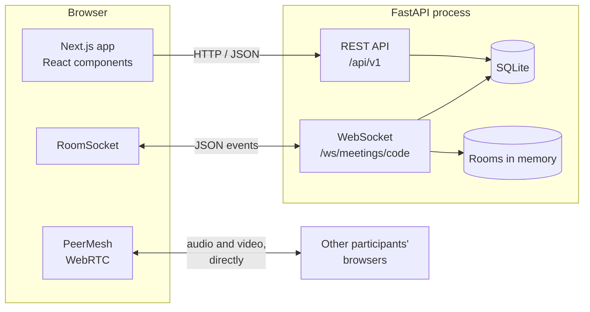
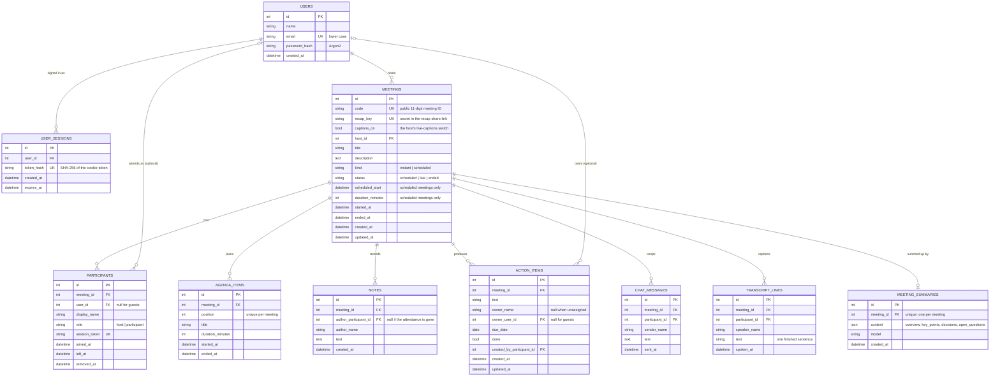
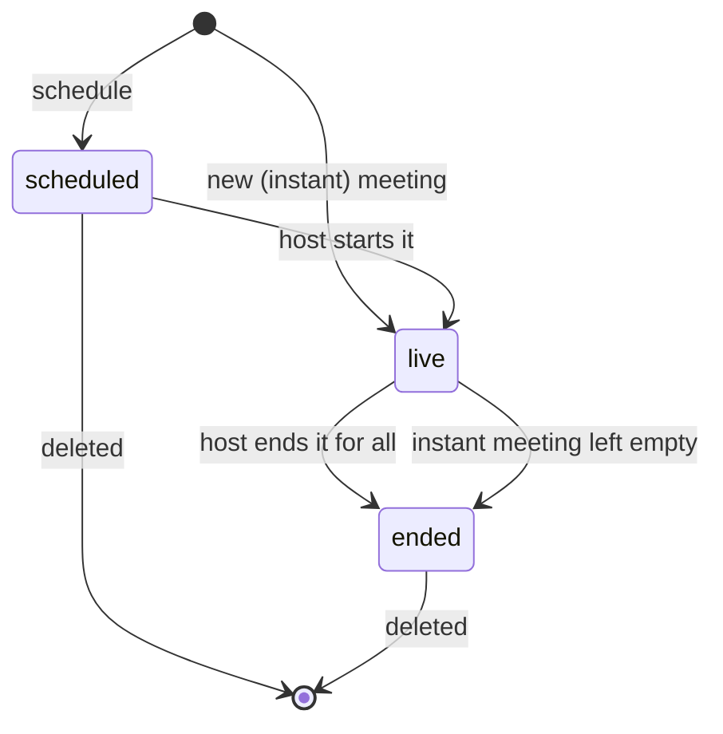
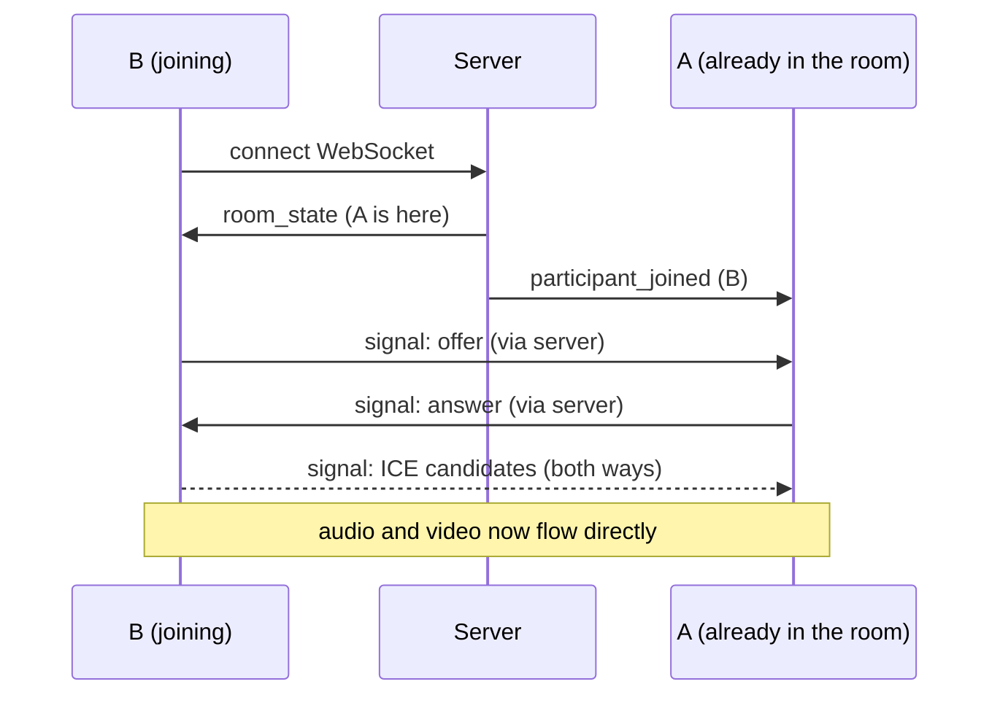

# Architecture

How HuddleFlow is put together, and why. Read this alongside the code:
each section names the files it describes.

## The big picture



There are three kinds of traffic:

| Traffic | Carries | Why this transport |
|---|---|---|
| REST over HTTP | Creating, listing, scheduling, joining | Request and response; easy to test and cache |
| WebSocket | Who is in the room, chat, mute state, host actions, WebRTC handshakes | The server must push events to browsers at any moment |
| WebRTC (peer to peer) | Audio and video | Media goes straight between browsers, so the server never handles video |

## Backend

`backend/app` is split into layers. Each layer only calls the one below it.

```
api/routes/     HTTP endpoints. Read the request, call a service, shape the response.
realtime/       The WebSocket endpoint, its event handlers and the room registry.
services/       The rules: what makes a meeting upcoming, who may start it, and so on.
models/         SQLAlchemy tables.
schemas/        Pydantic request and response shapes (validation lives here).
db/             Engine, session, shared column types, migrations runner, seed data.
core/           Settings, domain errors, time helpers.
```

Decisions worth knowing:

- **Thin routes, rules in services.** `api/routes/meetings.py` has no `if`
  statements about business rules. `services/meeting_service.py` can be tested
  and reused (the WebSocket layer calls it too) without HTTP.
- **Domain errors carry their HTTP status.** Services raise errors such as
  `MeetingNotFoundError` from `core/exceptions.py`. One handler in `main.py`
  converts any of them to `{"detail": "..."}`, the same shape FastAPI uses for
  its own errors, so the frontend parses one format.
- **One place decides who the user is.** `api/deps.py::get_current_user`
  reads the session cookie and returns the signed-in user, or answers 401.
  Routes just declare `user: CurrentUser`; the join route uses
  `OptionalUser`, because guests have no account.
- **All times are UTC.** `db/base.py::UTCDateTime` converts on the way into
  the database and tags values as UTC on the way out. The API rejects
  timestamps that have no timezone. The browser converts to local time.
- **One schema, two databases.** Production runs on MySQL 8; development and
  tests use SQLite. `db/base.py` hides the differences: tokens use a binary
  collation on MySQL (it compares text case-insensitively by default), and
  datetimes keep microseconds. CI runs every test on both.
- **The schema is versioned.** Alembic migrations in `backend/migrations` are
  applied when the app starts (`db/migrate.py`). Migrations are written with
  plain SQLAlchemy types, so later changes to the app cannot break old ones.
  A test checks that the migrations build exactly what the models describe.
- **Migrations never cascade on SQLite.** SQLite changes a column by copying
  the table, dropping the old one and renaming the copy. With foreign keys on,
  dropping `meetings` would delete every participant, note and agenda item.
  So `db/migrate.py` switches foreign keys off around the migration (outside
  the transaction, where SQLite honours it), checks every reference with
  `PRAGMA foreign_key_check` before committing, and switches them back on. A
  test fills the old schema with rows and checks they survive the upgrade.
- **The demo is always ready.** When the database has no meetings, startup
  gives the demo account sample meetings, so a fresh deploy is never empty.

### Database schema



Why it is shaped this way:

- **`meetings.code` is separate from `meetings.id`.** The code is what people
  type and share. Keeping the numeric primary key out of links means row
  counts and neighbouring meetings cannot be guessed from a link. Codes are
  generated with `secrets`, not `random`, so they are not predictable.
- **`participants.user_id` is nullable.** Guests join from a link with only a
  display name and have no account. A participant row is one attendance: it
  records who came, as what role, and when they joined and left.
- **`participants.session_token`** is a random secret given to the browser on
  join. It is how the WebSocket knows who is connecting, since guests cannot
  log in.
- **`removed_at`** stops someone the host removed from reconnecting with the
  same session.
- **Planned and actual times are separate columns.** `scheduled_start` and
  `duration_minutes` are the plan; `started_at` and `ended_at` are what
  happened. The "Recent" list shows the real length of a meeting.
- **Microphone and camera state are not stored.** They change many times a
  minute and mean nothing after the meeting, so they live in memory.
- **Constraints back up the code.** Enums are `VARCHAR` with `CHECK`
  constraints, which both SQLite and MySQL 8 enforce; a `CHECK` makes sure a scheduled
  meeting has a start and a duration; deleting a meeting cascades to its
  participants; foreign keys are switched on for every connection because
  SQLite ignores them by default.
- **Indexes match the queries.** Unique indexes on `code`, `email` and
  `session_token` serve the lookups; `(host_id, status)` serves the dashboard
  lists.

### Meeting lifecycle



A scheduled meeting counts as **upcoming** until its planned end time passes
or the host ends it. Everything else is **recent**.

### Who is the host?

The entry point decides the role:

- **Start** (the dashboard's New meeting or Start buttons) calls
  `POST /meetings/{code}/start`. It requires the signed-in user to own the
  meeting and creates a `host` participant.
- **Join** (an invite link, the Join dialog or the public `/join` page) calls
  `POST /meetings/{code}/join` and always creates an ordinary `participant`.
  No account is needed; if the visitor is signed in, the attendance is linked
  to their account.

The server checks the role again on every host-only WebSocket message
(`realtime/events.py::host_only`), because a browser can send anything.

### Accounts and sessions

- **Passwords** are hashed with Argon2 (`pwdlib`). A sign-in with an unknown
  email still checks a dummy hash, so the response time does not reveal which
  emails have accounts, and both cases return the same message.
- **Sessions are stored on the server.** Signing in creates a random token;
  the browser keeps it in an `HttpOnly`, `SameSite=Lax` cookie (and `Secure`
  in production) and the `user_sessions` table keeps only its SHA-256 hash and
  an expiry date. Signing out deletes the row, so a copied cookie stops
  working at once, which a self-contained token such as a JWT cannot do.
- **One site for the browser.** The frontend calls `/api/...` on its own
  address and Next.js forwards the request to the backend (a rewrite in
  `next.config.ts`). The cookie is therefore first-party; browsers increasingly
  block cookies set by a different site. The meeting WebSocket still connects
  to the backend directly and authenticates with the meeting token.
- **Guessing is slowed down.** `core/rate_limit.py` locks an email for 15
  minutes after 5 wrong passwords.
- **Redirects are checked.** After signing in the app returns to `?next=`,
  but only if that is a path on this site (`lib/auth.ts::safeNextPath`), so a
  crafted link cannot send people to another website.
- **Signed-out visitors** are sent to `/login` by `src/proxy.ts` before the
  dashboard renders. An expired cookie gets a 401 from the API, which also
  clears the cookie and leads to sign-in, so there is no redirect loop.

### The agenda

- **Progress lives in the database, not in memory.** Each `agenda_items` row
  has `started_at` and `ended_at`. The topic being discussed is the one that
  has started and not ended. A refresh, a reconnect or even a server restart
  keeps the agenda where it was, and the recap can compare planned and actual
  minutes.
- **Three host-only room messages** change it: `agenda_next` (start the
  first topic, move on, or finish on the last), `agenda_back` (undo the last
  Next) and `agenda_add`. Each is applied by `services/agenda_service.py` and
  answered with one `agenda_updated` broadcast holding the whole agenda, so
  every browser simply replaces its copy.
- **Timers agree across clocks.** `room_state` and `agenda_updated` carry the
  server's time. Each browser keeps the difference to its own clock
  (`lib/agenda.ts::clockOffset`) and counts down in server time.
- **Replacing an agenda** deletes the old rows before inserting the new ones;
  otherwise the new topic 1 would clash with the old topic 1 on the
  `(meeting_id, position)` unique constraint. A running meeting's agenda can
  only be extended from inside the meeting, so live progress is never wiped.

### Notes, action items and chat

Files: `backend/app/services/record_service.py`,
`backend/app/realtime/record_events.py`, `backend/app/api/routes/action_items.py`,
`frontend/src/components/meeting/NotesPanel.tsx`,
`frontend/src/components/dashboard/ActionItemsView.tsx`.

- **Written in the room, read anywhere.** During a meeting everything goes over
  the WebSocket, so every browser sees a change at once. After the meeting,
  the Action items page uses REST (`GET /action-items`, `PATCH /action-items/{id}`).
- **Names are copied, ids are kept.** A note stores the author's display name
  and their participant id. The name keeps the record readable for ever; the
  id says who may delete it. Foreign keys to participants use `SET NULL`, so
  the record survives if the attendance row is ever removed.
- **Owners come from the room.** The browser sends `owner_participant_id`; the
  server checks that person attended this meeting and copies their name and
  `user_id`. That is how an item assigned to a signed-in person lands on their
  own Action items page, while a guest's item still shows their name.
- **Who may do what.** Anyone in the room adds notes and items and can tick
  items, like a shared document. Deleting is for whoever added it, or the host.
  After the meeting, only the item's owner and the meeting's host can tick it,
  and anyone else gets a 404, so ids of other people's items reveal nothing.
- **Limits** keep a room small and fast: 2,000 characters per note and 500
  notes, 500 characters per item and 200 items per meeting, and the latest 200
  chat messages are sent to a joining browser.
- **Ticks are optimistic.** The checkbox changes at once. In the room the
  server's `action_item_saved` confirms it, and the full `room_state` sent on
  reconnect corrects anything lost; on the Action items page a failed request
  puts the tick back and shows the error.
- **Event handlers are split by feature.** `realtime/events.py` keeps the core
  room events and merges the handler tables of `agenda_events.py` and
  `record_events.py`. Shared helpers (who is acting, host-only checks, payload
  validation, "change the meeting and broadcast") live in `realtime/context.py`.

### The recap

Files: `backend/app/services/recap_service.py`, `frontend/src/app/recap/`,
`frontend/src/components/recap/`, `frontend/src/lib/recap.ts`.

- **Who may read it.** `GET /meetings/{code}/recap` answers the host, any
  signed-in person who attended (their attendance row has their `user_id`),
  and anyone whose `?key=` matches the meeting's `recap_key`. The key is
  compared in constant time. With no account and no key the answer is 401, so
  the browser goes to sign-in and comes back; a wrong key or someone else's
  meeting gets the same 404 either way.
- **How people get the link.** `room_state` carries the key to everyone in the
  room, and the "meeting ended" screen links to `/recap/{code}?key=...`. Only
  the host's recap response includes the full share URL, for the Share button.
  The key is a separate random value, never the participant's session token.
- **Attendance is merged.** Every entry to a room is its own participant row,
  so someone who rejoined has several. The recap groups rows by account, or by
  name for guests, and adds up the time, counting overlapping visits (two
  tabs) once. A visit with no leave time ends when the meeting ended.
- **Planned against actual.** Each agenda topic shows its planned minutes
  and how far over or under it ran; within a minute counts as on time, since
  real minutes are rounded.
- **Ending a meeting.** The host's End button only sends `end_meeting`; the
  server closes every socket, the host's included, and everyone lands on the
  ended screen with **View the recap**. If the host is offline at that moment
  the message cannot go out, so the button simply leaves as before.
- **Big meetings stay fast.** The recap includes the latest 1,000 chat
  messages and 2,000 transcript lines with their totals, and the page says
  when it is showing fewer.

### Live captions

Files: `frontend/src/lib/realtime/speechRecognizer.ts`,
`frontend/src/lib/realtime/captionThrottle.ts`,
`frontend/src/hooks/useSpeechCaptions.ts`,
`backend/app/realtime/caption_events.py`, `backend/app/services/caption_service.py`.

- **Speech becomes text in the speaker's browser.** Each browser runs the
  Web Speech API on its own user's microphone, only while the host has
  captions on and that user is unmuted, and sends the text. No audio goes
  through our server, so captions cost nothing to run and work with the
  peer-to-peer video.
- **Unfinished and finished text.** While someone talks, the recogniser keeps
  revising its guess; guesses go out as `caption` with `final: false` at most
  every 300 ms (`CaptionThrottle`) and are only displayed. A finished sentence
  goes out at once with `final: true` and is saved as a `transcript_lines` row.
- **The host's switch is in the database** (`meetings.captions_on`), so a
  refresh or a late joiner sees the right state. The server drops captions
  that arrive while it is off, including ones that were on their way when the
  host switched it off, so nothing is saved without the room being told.
- **The recogniser is restarted** when it stops by itself (after a pause or a
  minute of speech), at most 8 times in 30 seconds. If the browser refuses the
  microphone or keeps failing, it stops and the person is told why.
- **Browsers without the API** (Firefox) still show everyone else's captions,
  with a note that their own voice is not captioned.

### AI summaries

Files: `backend/app/services/llm.py`, `backend/app/services/summary_service.py`,
`backend/app/api/routes/summaries.py`, `frontend/src/components/recap/SummaryCard.tsx`.

- **One client for several providers.** Groq and OpenAI accept the same Chat
  Completions requests, so `OpenAICompatibleModel` uses the official `openai`
  SDK with a configurable `base_url`. Switching provider is a settings change.
  The rest of the app depends only on a small `JsonModel` protocol, which the
  tests replace with a fake.
- **Structured output.** The request includes a JSON Schema in strict mode, so
  the provider makes the answer match it. The answer is still validated with
  Pydantic (`SummaryContent`) before anything is saved; anything unexpected is
  reported as a 502 and the old summary stays.
- **Prompt injection.** The meeting's text was typed by participants, so the
  instructions say to treat it only as material to summarise. The output is
  shown as plain text, never as HTML.
- **Fitting the limits.** Groq's free tier allows about 8,000 tokens a minute.
  The record sent is capped (`LLM_MAX_INPUT_CHARS`, 16,000 by default):
  agenda, notes and action items first, then the transcript and chat share the
  rest; when too long, their start and end are kept and the middle is marked
  as left out. The answer is capped at `LLM_MAX_OUTPUT_TOKENS`.
- **Errors people understand.** A rate limit becomes "busy, try again in a
  minute" (429), an unreachable or misconfigured provider "can't be reached"
  (503, details only in the server log), and a cut-off or malformed answer
  "something unexpected" (502).
- **No double spending.** One request per meeting at a time, and 20 seconds
  between requests, so double clicks cannot use up a free plan.
- **Off without a key.** With no `LLM_API_KEY` the endpoint answers 404, the
  recap says `summaries_enabled: false`, and the button is not shown. The tests
  force the key empty so they can never call a real provider.

## Realtime layer

Files: `backend/app/realtime/`, `frontend/src/lib/realtime/`,
`frontend/src/hooks/useMeetingRoom.ts`.

Each browser in a meeting opens one WebSocket:
`/ws/meetings/{code}?token={session_token}`. Every message is JSON with a
`type`.

| Browser sends | Server sends | Purpose |
|---|---|---|
| (on connect) | `room_state` to the newcomer, `participant_joined` to the others | Presence |
| (on disconnect) | `participant_left` | Presence |
| `media_state` | `participant_updated` | Mute and camera icons |
| `chat` | `chat` | Meeting chat |
| `reaction` | `reaction` | Emoji reactions |
| `signal` (to one person) | `signal` | WebRTC handshake |
| `mute_all`, `mute_participant` (host) | `force_mute` to the target, `participant_updated` | Host controls |
| `remove_participant` (host) | `removed` to the target, `participant_left` | Host controls |
| `end_meeting` (host) | `meeting_ended` to everyone | Host controls |
| `agenda_next`, `agenda_back`, `agenda_add` (host) | `agenda_updated` | Agenda |
| `note_add`, `note_delete` | `note_added`, `note_deleted` | Shared notes |
| `action_add`, `action_update`, `action_delete` | `action_item_saved`, `action_item_deleted` | Action items |
| `captions_set` (host) | `captions_updated` | Live captions on or off |
| `caption` | `caption` | Live caption text; finished lines are saved |

The server closes a socket with a specific code when the session is over
(removed, meeting ended, replaced by another tab), and the browser shows the
matching full-page notice. Any other close is treated as a network drop and
the browser reconnects, up to five times.

Live rooms are a dictionary in the server process
(`realtime/rooms.py::RoomRegistry`). **This is why the backend runs as a single
process.** To scale beyond one process the registry would move to Redis
pub/sub so that processes can relay events to each other.

## Audio and video (WebRTC)

File: `frontend/src/lib/realtime/peerMesh.ts`.

Every participant holds a direct connection to every other participant (a
"mesh"). Connecting two browsers takes a short handshake, relayed by the
WebSocket:



- **The newcomer always calls.** Two browsers therefore never call each other
  at the same moment, which avoids a whole class of handshake conflicts.
- **Audio and video channels are always created**, even with the camera off.
  Turning the camera on, or switching to screen share, then only swaps the
  track with `replaceTrack`; no second handshake is needed.
- **A public STUN server** lets browsers behind home routers find each other.

Trade-off: in a mesh each person uploads their video once per other
participant, so it suits small meetings. Large meetings need a media server
(an SFU), which is what large meeting products use.

## Frontend

```
src/app/                 Routes (Next.js App Router)
  (auth)/                Sign in and sign up
  (dashboard)/           Home, Meetings and Action items, sharing the navbar and data
  recap/[code]/          A meeting's recap, also open to share-link holders
  join/                  Join by meeting ID without an account
  j/[code]/              The invite link: pre-join screen
  meeting/[code]/        The meeting room
src/components/
  ui/                    Generic pieces: Button, Modal, Popover, Toast...
  layout/                The app frame: top bar and navigation rail
  dashboard/             Tiles, lists, dialogs
  meeting/               Room, toolbar, panels, video tiles
  recap/                 The recap page and its sections
src/hooks/               Stateful logic shared by components
src/lib/                 Plain TypeScript with no React: API client, formatting, WebRTC
src/proxy.ts             Sends signed-out visitors from the dashboard to sign-in
```

- **One design system.** Every colour, shadow and animation is a token in
  `app/globals.css` (indigo brand, teal accent, navy rail, a dark meeting
  room), and Tailwind generates the utilities from those tokens, so a colour
  is changed in one place.
- **It behaves as a single page application.** Pages fetch from the API in the
  browser and move between routes without reloading. The meeting screens are
  loaded with `ssr: false` because they need the camera, `sessionStorage` and
  WebSockets, which only exist in a browser.
- **All HTTP calls go through `lib/api.ts`**, which turns every failure into an
  `ApiError` with a message that can be shown to the user.
- **Logic that is not about React is not in React.** `lib/` holds plain
  functions and classes (`PeerMesh`, `RoomSocket`, `LocalDevices`,
  `computeGridLayout`), which makes them unit-testable. Hooks connect them to
  components.
- **Devices are an external system.** `LocalDevices` owns the camera and
  microphone tracks; React subscribes with `useSyncExternalStore` rather than
  copying browser objects into state.
- **The dashboard shares one data source.** `DashboardProvider` loads the user
  and both meeting lists once and owns the dialogs, so Home and Meetings stay
  in sync after every change.
- **The session is per tab.** `lib/session.ts` keeps it in `sessionStorage`, so
  a refresh keeps your place in the meeting, and a second tab opened from the
  invite link is a separate participant.

## Testing

| Suite | Where | What it covers |
|---|---|---|
| Backend (pytest) | `backend/tests` | REST endpoints, validation, the WebSocket protocol including host controls, seed data |
| Frontend (Vitest) | `frontend/src/lib/*.test.ts` | Meeting ID parsing, date formatting, gallery layout |
| CI (GitHub Actions) | `.github/workflows/ci.yml` | Lint, type-check, tests and a production build on every push |

Backend tests run against an in-memory SQLite database, a fresh one per test.
